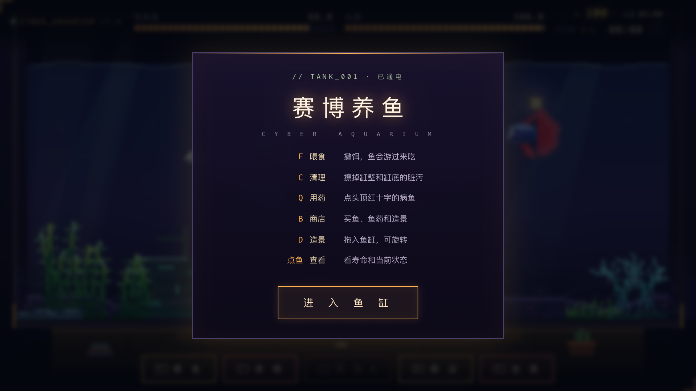

# 赛博养鱼 · CYBER AQUARIUM

一个单文件的像素风养鱼小游戏：喂食、清藻、用药、买鱼、摆造景，看鱼群在霓虹水族箱里慢慢长大。



## 玩法

- 开局 3 条鱼、100 起始资金，每 5 分钟结算一次收益。
- 鱼会饿，水质会变差；水质过低会长藻斑，鱼也会生病（头顶出现红十字）。
- 喂食让鱼恢复饱食度；清理擦掉藻斑、拉回水质；用药治好病鱼。
- 商店可以买鱼、买水草/造景，造景模式里把库存拖进鱼缸；造景会影响水质与收益。
- 进度自动保存在浏览器 `localStorage`，关掉页面再打开会接着上次的鱼缸。
- 界面支持中文 / English 切换：开始面板与游戏内 HUD 都能切，选择会记住，不影响当前进度。

> 当前为 **Demo 版**，稳定性修复后的预览发布。规则补充：全缸覆没后 60 秒内重新打开并点「抢救鱼缸」，鱼会以病危状态回来（并附赠 1 瓶鱼药），超过 60 秒则按判死进入结算；刷新页面不会免费复活，也不会清掉藻斑和粪便，脏污程度与下一次生成时间会原样续上（水中未吃完的散饵不保存）。

## 按键

| 按键 | 功能 |
| --- | --- |
| `F` / `空格` | 喂食，撒饵后鱼会游过来吃 |
| `C` | 清理：拖动海绵擦掉缸壁藻斑 |
| `Q` | 用药：点击头顶红十字的病鱼 |
| `B` | 商店：买鱼、药水、水草与造景 |
| `D` | 造景：从库存把水草/摆件拖进鱼缸 |
| `R` | 造景模式下旋转摆件 |
| `Esc` | 退出商店 / 造景模式 |
| 鼠标 | 点鱼查看状态，界面按钮也可直接点击 |

## 本地打开

不需要安装任何依赖，也不需要联网：

1. 下载本仓库；
2. 双击 `index.html`，用 Chrome / Edge / Safari 打开即可。

如果浏览器对本地文件有限制，可以起一个静态服务：

```bash
cd cyber-aquarium
python3 -m http.server 8080
# 然后打开 http://localhost:8080
```

## 演示视频

| 文件 | 规格 | 用途 |
| --- | --- | --- |
| `aquarium-demo.mp4` | 1920×1080 · 30fps · 42.7s | 横屏完整演示：进入鱼缸 → 喂食近景 → 商店买鱼与铁皇冠 → 造景入缸 → 清理（脏→净）→ 用药治病 → 收益结算 → 落版 |
| `aquarium-demo-vertical.mp4` | 1080×1920 · 30fps · 29.9s | 手机竖屏分享版，节奏更快，原生竖屏布局实机录制 |

两版都是实机录屏。音轨（city pop 器乐 + 水下环境声 + 交互音效）为程序合成，未使用第三方版权素材。

## 技术说明

- 单文件 HTML + Canvas 2D 像素渲染，无构建步骤、无运行时依赖。
- 横屏/竖屏自适应布局，桌面与手机浏览器都能玩。
- 存档与最佳成绩保存在 `localStorage`，清除站点数据会重置鱼缸。
